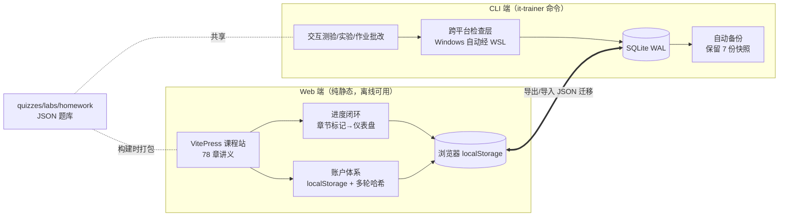

# it-infra-trainer — IT 基础设施工程师自学平台

> **离线优先的 IT 运维自学系统**：17 个课程模块 78 章 + 交互测验 + 动手实验 + 学习进度闭环，零基础到胜任 3 年经验岗位的完整路径。纯本地运行，无服务器、无订阅、断网可用。

[](../../actions/workflows/ci.yml)


## 这是什么

给零基础自学者的 **IT 基础设施工程师培训系统**——我用它把自己从零教到能胜任运维岗位。三个设计取舍决定了它的形态：

- **离线优先**：课程网站是纯静态站（VitePress），账户与进度存浏览器 localStorage——断网、内网、无后端都完整可用
- **双学习界面**：Web（阅读/进度/仪表盘）+ CLI（交互测验/实验/自动批改），共用一套题库与 SQLite 数据
- **练习是真实的**：作业的实操题在 WSL 里执行真实命令做环境检查（文件存在/端口监听/服务状态），不是选择题模拟

## 架构（30 秒版）



工程护栏：`npm test` = 21 项语法检查 + 5 项 CLI 冒烟 + 生产构建产物校验，任何改动必须全绿（[smoke-test.js](scripts/smoke-test.js)）。

## 值得深挖的三件事

1. **架构决策记录（ADR）** — 为什么砍掉默认启动的认证服务、为什么选择双数据域、备份为什么先做 WAL 检查点 → [docs/adr.md](docs/adr.md)
2. **踩坑复盘** — 6 个真实生产级 bug 的完整取证过程（含 cmd 代码页陷阱、仪表盘进度恒为 0% 的考古） → [docs/retrospective.md](docs/retrospective.md)
3. **AI 结对开发工作流** — 本项目 70% 实现由 AI 辅助完成，全程"探索→计划→执行→验证"小步提交，见 git 历史与 [AGENTS.md](AGENTS.md)

## 在线体验

部署后此处放访问地址（见 [DEPLOY.md](DEPLOY.md)，推送 GitHub 后自动发布）。

打开后点击仪表盘「载入演示数据」即可看到带进度的完整效果，无需注册。

## 快速开始（本地）

```bash
npm install && npm run init-db
npm test        # 自检：语法 + CLI 冒烟 + 构建
npm run dev     # 启动，就绪后自动打开浏览器
```

或 Windows 双击 `启动学习助手.bat` 一键启动。完整使用说明见 [使用文档](使用文档.txt)。

## 项目规模与演进

| 维度 | 数据 |
|------|------|
| 课程内容 | 17 模块 / 78 章 / 5 份题库 59 题 / 2 实验 / 3 作业 |
| 代码 | Node.js 20 ESM；CLI 12 命令 + Express 可选组件 + VitePress 主题 |
| 质量护栏 | npm test（21+5+构建）；git 全程小步提交，25+ commits 可回放演进 |
| 两轮架构演进 | v2.2：单进程化/隐私整改/安全加固/进度闭环/自动备份 → v2.3：内容补全至无空白板块 |

## 技术栈

Node.js · VitePress/Vue 3 · better-sqlite3（WAL）· commander/inquirer · WSL2 互操作 · GitHub Actions

## License

MIT
