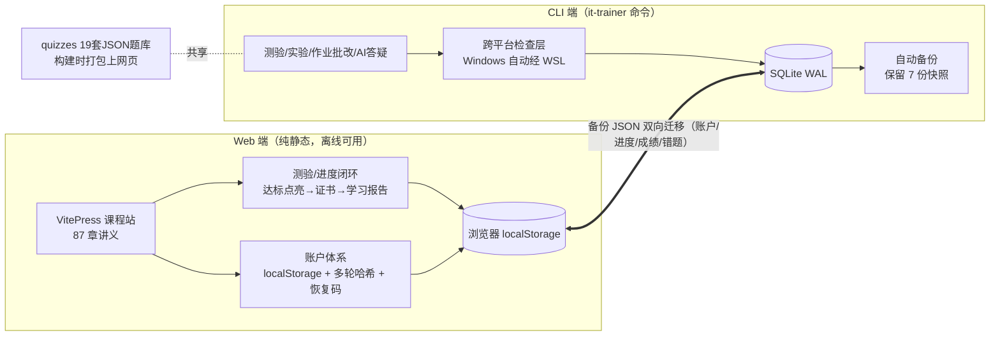

# it-infra-trainer — IT 基础设施工程师自学平台

> **离线优先的 IT 运维自学系统**：17 个课程模块 87 章讲义 + 19 套题库 184 题（含 AI 判卷的问答/实操题）+ 动手实验 + 测验达标驱动的进度闭环，零基础到胜任 3 年经验岗位的完整路径。纯本地运行，无服务器、无订阅、断网可用。

[](../../actions/workflows/ci.yml)


## 这是什么

给零基础自学者的 **IT 基础设施工程师培训系统**——我用它把自己从零教到能胜任运维岗位。四个设计取舍决定了它的形态：

- **离线优先**：课程网站是纯静态站（VitePress），账户与进度存浏览器 localStorage——断网、内网、无后端都完整可用
- **练习是真实的**：作业的实操题在 WSL 里执行真实命令做环境检查（文件存在/端口监听/服务状态），不是选择题模拟
- **完成由证据驱动**：阅读标记只是轨迹，**模块测验 ≥80 分才点亮全部章节**（双轨机制，ADR-009）；学习报告里"测验达标验证"与"仅自报已读"永远分开呈现
- **AI 是可选增益**：问答/实操题 AI 三档判卷 + 错杀对抗审计，密钥 BYOK（访客自带，只存本机浏览器，站点零密钥）；不配密钥一切照用（自评模式，ADR-010）

产品定位、目标用户、竞品对照与度量设计见 **[docs/product.md](docs/product.md)**。

## 架构（30 秒版）



工程护栏：`npm test` = 语法/存在性检查 + CLI 冒烟 + **题库结构与效度校验**（正确答案索引分布失衡会直接拦截——防"连点同一选项刷分"）+ 生产构建；`npm run test:e2e` = Playwright 三旅程断言（标记→进度写入 / 达标→模块点亮 / 无密钥自评不计分），CI 独立 job 运行。

## 3 分钟评估动线

线上打开 **https://emiyapeter.github.io/it-infra-trainer/** ：

1. 首页底部「🧪 载入演示数据」——仪表盘即刻呈现带进度的完整效果（含达标模块、可下载证书）
2. 顶部导航「📝 随堂测验」——任选一套题做完，≥80 分看模块章节自动点亮；配自己的 AI 密钥可体验问答/实操题判卷
3. 仪表盘「📋 学习报告」——看"测验达标验证 / 仅自报已读 / 未开始"三种证据如何分开呈现

（本地部署与离线用法见 [DEPLOY.md](DEPLOY.md)）

## 值得深挖的四件事

1. **产品文档** — 定位/用户/JTBD/竞品/北极星指标，以及"人机分工实录"（哪些关键产品决策是人提出的） → [docs/product.md](docs/product.md)
2. **架构决策记录（ADR×11）** — 为什么砍掉认证服务、双数据域、BYOK 边界、双轨完成机制、无密钥不惩罚原则、恢复码的威胁建模 → [docs/adr.md](docs/adr.md)
3. **踩坑复盘（11 坑）** — 真实 bug 的完整取证（cmd 代码页陷阱、进度恒 0% 的考古、glob 静默空对象、VitePress 文件名约定两连坑） → [docs/retrospective.md](docs/retrospective.md)
4. **题库审校报告** — AI 出题 → 人工审校修正（索引分布/干扰项效度/事实核查）→ 校验护栏固化，含逐卷修正清单 → [docs/question-audit.md](docs/question-audit.md)

## 安全与边界（FAQ）

- **BYOK 密钥会被偷吗？** 密钥只存用户本机浏览器的 localStorage，站点代码与仓库零密钥，请求由用户浏览器直连所选服务商。风险边界=用户本机（ADR-008 修订版）
- **结业证书能伪造吗？** 证书由本机浏览器 canvas 生成，明确标注"自学完成证明·非官方认证"；它的价值在于与学习报告一致的**证据分级**（测验达标 vs 自报已读），不冒充第三方凭证（ADR-011）
- **隐私数据在哪？** 全部学习数据（账户/进度/成绩/错题）只在本机浏览器与本地 SQLite，发布物经隐私审计（PII 零入库）；备份文件含密码哈希，导出提醒用户妥善保管

## 快速开始（本地）

```bash
npm install && npm run init-db
npm test          # 自检：语法 + 冒烟 + 题库校验 + 构建
npm run test:e2e  # E2E 旅程测试（Windows: E2E_CHANNEL=msedge）
npm run dev       # 启动，就绪后自动打开浏览器
```

或 Windows 双击 `启动学习助手.bat` 一键启动。完整使用说明见 [使用文档](使用文档.txt)。

## 项目规模与演进

| 维度 | 数据 |
|------|------|
| 课程内容 | 17 模块 / 87 章 / 19 套题库 184 题（人工审校）/ 2 实验 / 3 作业 |
| 代码 | Node.js 20 ESM；CLI 12 命令 + VitePress 主题（判分/报告/证书/模拟考均为原生实现零前端额外依赖） |
| 质量护栏 | npm test 4 步 + Playwright E2E 3 旅程；32+ commits 小步可回放 |
| 演进（v2.1→v2.7） | 工程化 → 内容全覆盖 → 作品化上线 → Web 测验+BYOK AI 判卷 → 题库全模块+主观题 → 账户安全+学习闭环（恢复码/证书/报告/模拟考/E2E） |

## 技术栈

Node.js · VitePress/Vue 3 · better-sqlite3（WAL）· commander/inquirer · Playwright · WSL2 互操作 · GitHub Actions（CI + Pages）

## License

MIT
