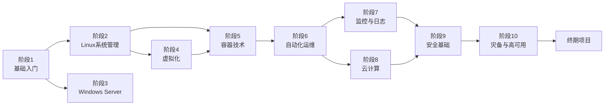

# 学习路线图总览

本路线图参照一线企业 IT 基础设施工程师岗位要求设计，涵盖从零基础到独立搭建和管理企业级基础设施的全部核心技能。

## 学习路径概览



## 技能树

```
IT 基础设施工程师
├── 计算机基础
│   ├── 硬件组成 (CPU/内存/存储/主板)
│   ├── 操作系统概念 (进程/内存管理/文件系统)
│   ├── 进制转换 (二进制/十六进制)
│   └── 硬件故障诊断与维修 ⭐ 新增
├── 故障排查与运维 ⭐ 新增
│   ├── 电脑维修基础 (硬件检测、故障更换、启动排查)
│   ├── 网络异常排查 (连通性、DNS、IP冲突)
│   ├── 网页访问异常 (浏览器、HTTPS证书、代理)
│   ├── 系统常见异常 (卡顿、蓝屏、更新故障)
│   └── 打印机异常排查 (脱机、队列卡住、质量异常)
├── 网络技术 ⭐ 核心
│   ├── OSI 七层模型
│   ├── TCP/IP 协议栈
│   ├── IP 寻址与子网划分
│   ├── 路由与交换
│   ├── DNS / DHCP / NAT
│   ├── VLAN / VPN
│   └── 防火墙与网络安全
├── Linux 系统管理 ⭐ 核心
│   ├── 命令行操作 (Bash)
│   ├── 用户与权限管理
│   ├── 进程与服务管理 (systemd)
│   ├── 存储管理 (LVM, RAID, NFS)
│   ├── Shell 脚本编程
│   ├── 软件包管理 (apt/yum)
│   └── 性能监控与故障排查
├── Windows Server
│   ├── Active Directory 域服务
│   ├── 组策略管理 (GPO)
│   ├── DNS / DHCP 服务
│   ├── PowerShell 自动化
│   └── 文件服务器与权限
├── 虚拟化技术
│   ├── 虚拟化原理
│   ├── VirtualBox / VMware
│   ├── KVM / QEMU
│   ├── Hyper-V
│   └── 资源管理与性能调优
├── 容器与编排
│   ├── Docker 核心 (镜像/容器/网络/存储)
│   ├── Docker Compose
│   ├── Kubernetes 基础
│   └── 容器安全
├── 自动化与 IaC
│   ├── Ansible 配置管理
│   ├── Terraform 基础设施即代码
│   ├── CI/CD 流水线
│   └── Git 版本控制
├── 监控与可观测性
│   ├── Prometheus 指标收集
│   ├── Grafana 可视化
│   ├── ELK 日志分析
│   └── 告警与值班
├── 云计算
│   ├── AWS 核心服务
│   ├── Azure 基础
│   ├── 成本管理
│   └── 混合云架构
├── 安全
│   ├── 网络安全 (防火墙/IDS/IPS)
│   ├── 身份与访问管理 (IAM)
│   ├── PKI 与证书
│   └── 安全合规
└── 灾备与高可用
    ├── 备份策略 (3-2-1规则)
    ├── 负载均衡
    ├── 故障转移
    └── DR 规划
```

## 时间投入建议

| 阶段 | 建议时长 | 每日学习 | 难度 |
|------|---------|---------|------|
| 阶段1：基础入门 | 3个月 | 1-2小时 | ⭐ 入门 |
| 阶段2：Linux系统管理 | 5个月 | 1-2小时 | ⭐⭐ 基础 |
| 阶段3：Windows Server | 2个月 | 1-2小时 | ⭐⭐ 基础 |
| 阶段4：虚拟化技术 | 2个月 | 1-2小时 | ⭐⭐ 基础 |
| 阶段5：容器技术 | 4个月 | 1-2小时 | ⭐⭐⭐ 中级 |
| 阶段6：自动化运维 | 4个月 | 1-2小时 | ⭐⭐⭐ 中级 |
| 阶段7：监控与日志 | 2个月 | 1-2小时 | ⭐⭐⭐ 中级 |
| 阶段8：云计算基础 | 3个月 | 1-2小时 | ⭐⭐⭐ 中级 |
| 阶段9：安全基础 | 2个月 | 1-2小时 | ⭐⭐⭐⭐ 进阶 |
| 阶段10：灾备与高可用 | 2个月 | 1-2小时 | ⭐⭐⭐⭐ 进阶 |
| 终期项目 | 6个月 | 灵活 | ⭐⭐⭐⭐⭐ 综合 |

## 学习建议

1. **循序渐进** — 必须按阶段顺序学习，每个阶段建立在前一阶段基础之上
2. **动手优先** — 每学完一个概念，立即在终端中动手验证。不要只看不练
3. **遇到问题先自己排查** — 故障排查是IT工程师最核心的能力
4. **做好笔记** — 用 Markdown 记录自己的理解和遇到的坑
5. **搭建实验环境** — 虚拟机和容器是你的沙盒，大胆尝试不要怕搞坏
6. **坚持每天** — 每天1-2小时比周末突击一整天效果好得多

## 下一步

👉 [开始阶段1：基础入门 →](/roadmap/phase-1-foundation)
